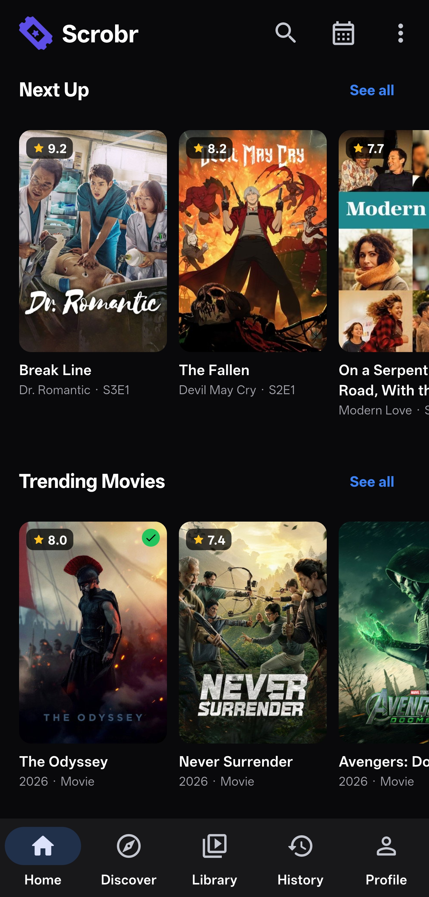
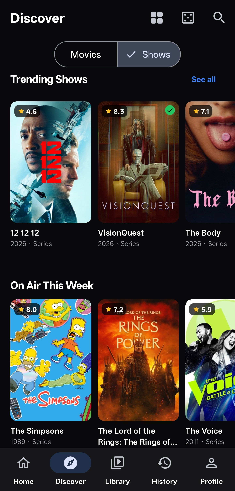

# Scrobr

Scrobr is a native Flutter client for [Scrob](https://github.com/ellite/scrob) — the
self-hosted media tracker (Letterboxd + Trakt for your own library).

The app talks to the Scrob backend through the same `/api/proxy` surface the
PWA uses. It supports JWT username/password sessions, optional API-key sessions,
and the main browsing, tracking, social and settings flows of the web UI.

## Screenshots

| Home | Discover |
| --- | --- |
|  |  |
| **Watch history** | **Calendar** |
|  |  |

## Features

- First launch asks for your own Scrob server URL and verifies it before saving.
  Password login with TOTP/backup-code challenge, "stay logged in", registration
  and API-key sign-in.
- Dashboard: continue watching, next up, airing today, now playing, recently
  added and trending rows.
- Discover: trending, now playing / on air, upcoming / new episodes, top rated,
  for you, hidden gems and streaming rows for movies and shows.
- Explore screen for movies/shows: popular, top rated and trending categories
  with genre, year, rating, watch-state and list filters.
- Optional Library tab (off by default; enable in Settings) for movies and shows
  with sort, watched/rating/list/year/genre filters, saved presets and infinite
  scrolling.
- Search across TMDB movies, shows and people, plus Scrob user search.
- Movie, show, season, episode, person, collection and studio/company pages
  with cast, crew, recommendations, release dates and where-to-watch.
- Trending trailer row on Discover.
- Actions: mark watched/unwatched (item, season or show), 1–10 ratings,
  comments with spoilers, Trakt community comments (when enabled), add to list,
  collect/request, drop/undrop, rewatch, trailer launch and timed manual
  watching sessions.
- Watch history with date grouping, filters, per-entry delete and unwatch.
- Lists (watchlist, private/friends/public), create/edit/delete and item
  management.
- Profiles with follow/unfollow, top rated and recently watched rows with
  paginated “see all” pages, stats charts (watch time, activity, ratings,
  weekdays, genres) and public profiles.
- Calendar, progress, dropped, existing connection management (toggles,
  schedules, push/sync controls) and About.
- Settings: preferences, API-key regeneration, password/email/2FA, connected
  apps, native ZIP data export/import, manage-on-web links for
  providers/integrations and an admin panel for settings, users, requests,
  maintenance and database backup/restore.
- Release APK workflows: pre-release universal builds on `v*` tags/manual dispatch, and a manual all-ABI release workflow.

## Run

```sh
flutter pub get
flutter run
```

On first launch the app asks for your own Scrob server URL, verifies it, and
then saves it. No server is bundled or assumed.

## Build

```sh
flutter build apk --release
```

Release builds are currently signed with the debug key so they are directly
installable. Add a keystore and signing config before publishing.

See [PARITY.md](PARITY.md) for the web-to-native feature map and deliberate
exclusions.

## Engineering

- Artwork is disk-cached through `cached_network_image` with the session
  headers; public TMDB/TVDB URLs are the fallback.
- Bottom tabs are built lazily on first visit.
- API calls time out after 20 seconds; binary and multipart calls share the
  same 401 handling as normal requests.
- CI runs `flutter analyze --no-fatal-infos` and `flutter test` on pull requests
  and pushes to `main` (`.github/workflows/ci.yml`).

## Release workflow

`.github/workflows/release.yml` builds the universal APK on:

- `workflow_dispatch` with a version tag input (defaults to the ref name), or
- a pushed tag such as `v1.2.3`.

The tag version is passed to Flutter as `--build-name`; the workflow uploads
`scrobr-<version>-universal.apk` as a build artifact and publishes it as a
**pre-release** (including for manual dispatches).

`.github/workflows/release-all-abis.yml` is manual-dispatch only and requires a
version tag. It builds four APKs:

- `scrobr-<version>-universal.apk`
- `scrobr-<version>-arm64-v8a.apk`
- `scrobr-<version>-armeabi-v7a.apk`
- `scrobr-<version>-x86_64.apk`

It publishes them as a full release (promoting an existing pre-release for the
same tag when applicable) and marks it latest. Use the normal workflow for
testing/pre-releases and this one for the final multi-architecture release.

### Signing

The workflow signs with a keystore supplied as repository secrets; without
them it falls back to the debug key so the build still succeeds.

| Secret | Value |
| --- | --- |
| `ANDROID_KEYSTORE_BASE64` | base64 of the `.jks`/`.keystore` file |
| `ANDROID_KEYSTORE_PASSWORD` | keystore password |
| `ANDROID_KEY_ALIAS` | key alias |
| `ANDROID_KEY_PASSWORD` | key password |

On Windows, produce the base64 value with:

```powershell
[Convert]::ToBase64String([IO.File]::ReadAllBytes("release.jks"))
```

The workflow decodes it to `android/app/release.keystore`, writes the ignored
`android/key.properties`, builds, and signs the release APK with it.

## API notes

The backend OpenAPI document is admin-only (`GET /openapi.json`). A local
snapshot can be regenerated under the ignored `.tmp/` directory when needed.
See `.skills/scrob-api/SKILL.md` for the API workflow and
`.skills/flutter-android/SKILL.md` for the local toolchain. Build outputs,
Flutter/Gradle caches and `.tmp/` are disposable and are not committed.

API keys can read/write data endpoints, but account, comments, connections and
`/admin/*` need a real JWT session. The app shows an API-key session as such and
opens the password-only screens when you sign in normally.

Deliberately out of scope: OIDC/SSO login and in-app video playback. Provider
linking (Jellyfin/Plex/Emby/Nuvio/Stremio/ARVIO and the cloud trackers) is done
in the Scrob web UI; the app opens that page and manages existing connections.
